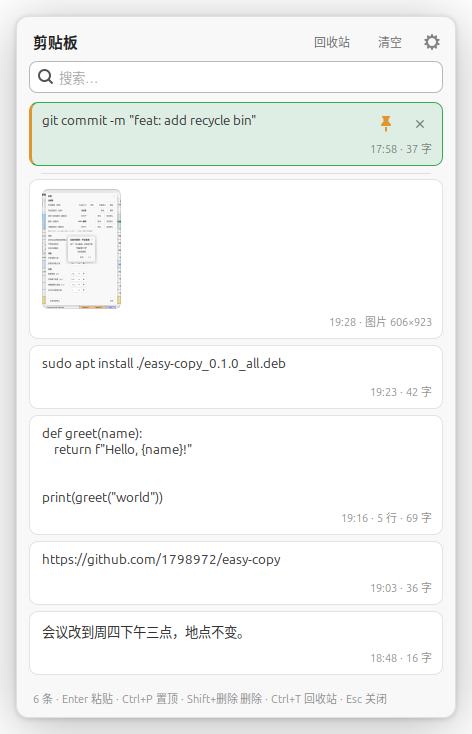
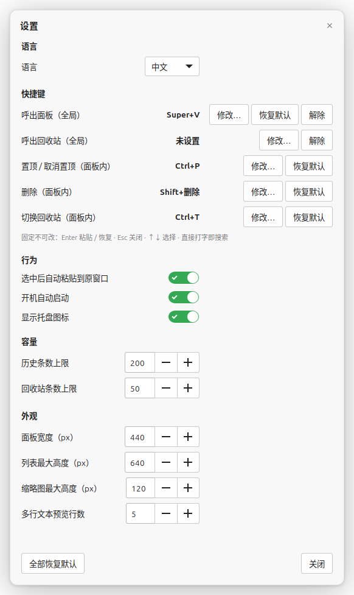

# easy-copy

[中文](README.md)

A minimal clipboard history for Linux, in the spirit of Windows' Win+V: press a hotkey, pick an entry, it gets pasted.
Plain Python + GTK3; the libraries that ship with Linux Mint / Ubuntu are all it needs.



## Features

- Records **text and images** in the background, de-duplicated; copying something again moves it to the top; keeps 200 entries by default
- **Super+V** opens the panel at the mouse pointer; just type to filter
- `↑` `↓` or mouse movement selects; `Enter` or a click puts the entry on the clipboard and **pastes it** into the previous window (terminals get Ctrl+Shift+V automatically)
- **Pin** entries you paste often so new copies never push them down; "Clear" leaves them alone
- **Recycle bin**: deleting needs no confirmation and goes to the bin (50 entries by default); permanent deletion is confirmed inline; entries can be restored
- Tray icon, autostart, follows the desktop theme (dark themes included)
- Chinese / English interface

## Requirements

- An X11 session (under Wayland other apps' clipboard changes are not observable and xdotool does not work; Mint uses X11 by default, on Ubuntu GNOME pick "Xorg" at the login screen)
- Python 3.10+, PyGObject, GTK 3; automatic global hotkey registration supports **Cinnamon** and **GNOME**, other desktops can bind the command manually
- Packages (Debian / Ubuntu / Mint names): `python3-gi python3-gi-cairo gir1.2-gtk-3.0 gir1.2-gdkpixbuf-2.0 xdotool x11-utils`; optional `gir1.2-ayatanaappindicator3-0.1` (tray icon) and `libnotify-bin` (first-run notice)

## Install

**Option 1: deb package** (Mint / Ubuntu / Debian, from Releases)

```bash
sudo apt install ./easy-copy_0.1.0_all.deb
```

Launch "easy-copy" from the application menu or press Super+V: the first start registers the hotkey and enables autostart.

**Option 2: clone and run**

```bash
git clone https://github.com/1798972/easy-copy.git
cd easy-copy
./install.sh
```

`install.sh` symlinks `bin/easy-copy` into `~/.local/bin`, writes the autostart entry, registers Super+V and starts the daemon.
Pick another hotkey with `EASY_COPY_HOTKEY='Ctrl+Alt+V' ./install.sh`. Uninstall with `./install.sh --uninstall` (history is kept).

## Usage

| Action | Keys |
|---|---|
| Show / hide the panel | Super+V (configurable) |
| Filter | just type |
| Select | ↑ ↓ or move the mouse |
| Paste | Enter or click |
| Pin / unpin | Ctrl+P (configurable) or the 📌 on the card |
| Delete to the recycle bin | Shift+Delete (configurable) or the ✕ on the card |
| Open the recycle bin | Ctrl+T (configurable) or the header button |
| Restore / delete permanently in the bin | Enter / Shift+Delete twice |
| Close | Esc or click elsewhere |

## Settings

Tray icon → "Settings…", the ⚙ in the panel header, or `easy-copy settings`.



| Group | Items |
|---|---|
| Language | System default / 中文 / English |
| Shortcuts | Open panel, open recycle bin (global); pin, delete, toggle recycle bin (in panel). Conflicts are checked as you press the keys: a clash with a system shortcut is flagged and can be applied anyway, internal clashes are refused |
| Behavior | auto-paste, start at login, tray icon |
| Capacity | history limit (200), recycle bin limit (50) |
| Appearance | panel width, list max height, thumbnail max height, preview lines for multi-line text |

Configuration lives in `~/.config/easy-copy/config.json`, history in `~/.local/share/easy-copy/`.

## Command line

```
easy-copy            start the daemon
easy-copy toggle     show / hide the panel (this is what the hotkey runs)
easy-copy trash      open the recycle bin
easy-copy clear      clear the history (into the recycle bin)
easy-copy hotkey     show the hotkey; easy-copy hotkey 'Ctrl+Alt+V' changes it; --remove unbinds
easy-copy settings   open settings
easy-copy version    print the version
easy-copy quit       stop the daemon
```

## Known limitations

- X11 only; no Wayland support
- Global hotkeys are registered automatically only on Cinnamon / GNOME; on KDE / XFCE / MATE bind `easy-copy toggle` to a key in the system keyboard settings
- Auto-paste relies on xdotool; a few applications ignore synthetic key events, in which case the entry is already on the clipboard and a manual Ctrl+V does the job

## Development

```bash
./bin/easy-copy          # run from the repository
python3 -m pytest tests  # pure-logic tests (history, config, hotkeys, translations)
python3 -m pyflakes src
./build-deb.sh           # produces dist/easy-copy_<version>_all.deb
```

Code lives in `src/easy_copy/`: `history.py` (history and recycle bin), `hotkey.py` (key parsing and validation), `desktop.py` (desktop integration: hotkey registration, autostart, paste), `ui/` (GTK interface), `i18n.py` (translation table).

## License

MIT
